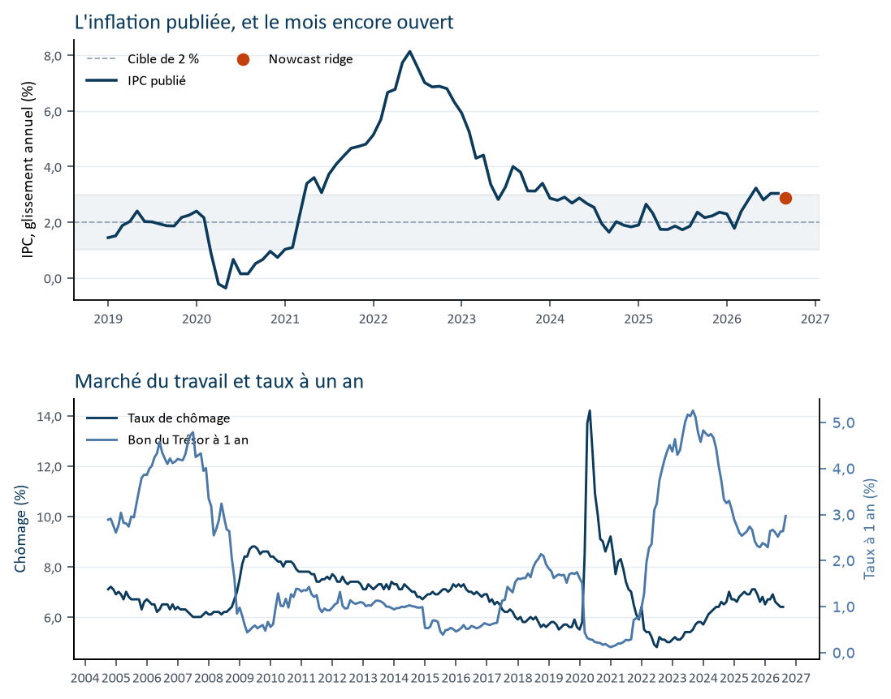
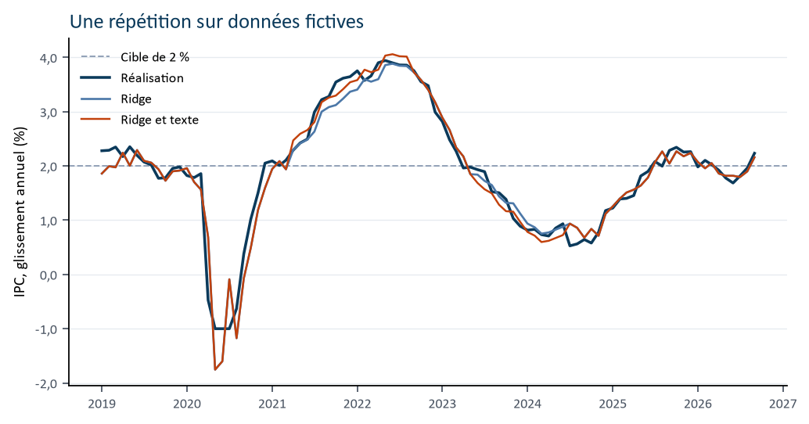
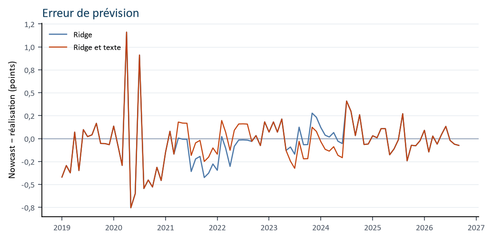

# L'inflation canadienne, lue avant le chiffre

*Chaque mois, avant le communiqué de Statistique Canada, une régression donne une lecture du glissement annuel de l'IPC. Elle ne voit que ce qui est déjà publié.*

Un glissement annuel dit de combien le panier de l'IPC coûte plus cher qu'il y a douze mois. La cible de la Banque du Canada est 2 %, au milieu d'une fourchette de 1 à 3 %. Cette page est une lecture de travail. Ce n'est pas une prévision de la Banque du Canada.

<!-- lecture:debut -->
## La lecture du 31 octobre 2026

Le mois encore ouvert est **octobre 2026**. La régression, estimée sur 114 mois déjà publiés, lit **3,13 %** de glissement annuel. La bande à 80 % va de **2,69 %** à **3,58 %**. La probabilité de dépasser 2 % est **0,999**.

Les textes de la Banque déjà dans la fenêtre ne déplacent pas ce chiffre.

Sur la répétition fictive, l'erreur moyenne est de 0,18 point de glissement annuel, sur 93 mois. Le score de Brier, qui note la probabilité de dépasser 2 %, est de 0,078.



*Le trait bleu est l'IPC déjà publié. Le point orange est le mois encore ouvert. La zone pâle est la fourchette de maîtrise, de 1 à 3 %.*
<!-- lecture:fin -->

## Ce que le chiffre raconte

La lecture porte sur le prochain mois d'IPC dont le chiffre n'est pas encore sorti. Autour du point, une bande à 80 % dit où le chiffre a des chances de tomber si l'erreur des mois passés se répète. Quand toute la bande est au-dessus de 2 %, la lecture place l'inflation hors de la cible, tout en restant peut-être dans la fourchette de 1 à 3 %.

La probabilité jointe au chiffre répond à une question simple : quelle chance que l'impression dépasse 2 % ? Une impression exactement égale à 2 % ne compte pas comme un dépassement.

## Ce qui entre dans la lecture

L'idée vient d'[IT Now](https://naffe15.github.io/nowcast/), le nowcast du PIB italien tenu par Filippo Ferroni. Le même genre de séries est repris pour le Canada. La cible, ici, est l'inflation, pas le PIB.

Le mois d'IPC encore ouvert n'entre pas dans le calcul. On utilise l'inflation déjà connue, à un mois, à deux mois, à trois mois et à un an. Autour d'elle :

- les ventes au détail en volume, qui disent si les ménages achètent ;
- le taux de chômage ;
- la confiance des ménages et celle des entreprises, deux indices qui tournent autour de 100 ;
- l'activité des usines canadiennes, lue à travers les livraisons manufacturières ;
- l'activité des usines américaines, le partenaire qui joue pour le Canada le rôle de l'Allemagne pour l'Italie ;
- les exportations et les importations ;
- la dernière croissance trimestrielle du PIB réel déjà publiée ;
- le bon du Trésor à un an.

## Le calendrier, en une image

La veille du chiffre, tout n'arrive pas en même temps. L'emploi du mois est souvent déjà là. Les ventes au détail, le commerce et les usines du même mois ne le sont pas. La lecture prend la dernière observation publique de chaque série, et elle note depuis combien de mois cette observation date.

Un texte n'entre que si sa date tombe après le précédent IPC et au plus tard à l'heure de la lecture. Une page déjà en ligne pour le lendemain reste dehors. Un document qui répète le chiffre le matin de sa publication reste dehors lui aussi : à la veille, on ne le connaît pas.

Les textes de la Banque peuvent déplacer la lecture d'au plus un quart de point, quand ils apportent une nouvelle qui n'est pas déjà dans les séries, et quand la citation est dans le paquet. S'ils se taisent, ou s'ils redisent ce que le chômage et les taux montrent déjà, le chiffre ne bouge pas.

## Est-ce que la méthode a déjà vu juste

La même règle est rejouée sur un Canada fictif, la veille de chaque publication. L'erreur moyenne est le nombre de points dont la lecture manque le chiffre, sans regarder le signe. Le score de Brier note les probabilités : plus il est près de zéro, plus elles étaient justes. Cette répétition vérifie le calendrier. Elle ne raconte pas l'histoire du Canada. Les scores du dernier passage sont dans la lecture du jour, en haut de page.



*Le trait bleu est le chiffre qui sort le lendemain. Les deux autres traits sont la lecture de la veille. La ligne pointillée est la cible de 2 %.*



*Au-dessus de zéro, la lecture de la veille était trop haute.*

## Ce que cette lecture ne dit pas

Le calendrier ignore les jours fériés, hors les fins de semaine. Les révisions de Statistique Canada restent dans les séries : on lit le dernier millésime.

La bande à 80 % reprend l'erreur des mois déjà estimés. IT Now, lui, trace ses bandes en simulant un modèle bayésien à fréquences mixtes. Ici, l'estimateur reste une régression ridge, avec un réglage fixé d'avance.

Statistique Canada ne publie pas d'indice de production industrielle au sens européen. Les livraisons des usines en tiennent lieu. Les textes officiels sont le titre, la date et le résumé, pas le discours entier.

## D'où viennent les séries

| Série | Source | Identifiant |
| --- | --- | --- |
| IPC, sur un an | StatCan 18-10-0004 | v41690973 |
| PIB réel | StatCan 36-10-0104 | v62305752 |
| Ventes au détail, volume | StatCan 20-10-0067 | v1446870181 |
| Chômage | StatCan 14-10-0287 | v2062815 |
| Confiance des ménages | OCDE, indice autour de 100 | CCICP |
| Confiance des entreprises | OCDE, indice autour de 100 | BCICP |
| Usines canadiennes | Livraisons manufacturières, StatCan 16-10-0013 | v123263908 |
| Usines américaines | FRED | INDPRO |
| Bon du Trésor à un an | Banque du Canada, Valet | V80691346 |
| Exportations et importations | StatCan 12-10-0011 | v87008955, v87008839 |

Les identifiants ont été vérifiés le 30 octobre 2026. La note Word, avec les mêmes graphiques, est dans `rapports/Note_nowcast_IPC_Canada_0927.docx`. La version anglaise de cette page est `README.en.md`.

```powershell
python build_report.py
```

## Les formules

Elles décrivent le calcul tel qu'il est estimé. On peut lire l'article sans les ouvrir.

<details>
<summary>La moyenne du mois encore ouvert</summary>

Le mois \(t\) est le premier IPC dont la publication est encore strictement après l'heure \(\tau\). Le vecteur \(x_{t\mid\tau}\) ne contient que des observations déjà publiques à cette heure.

$$
\pi_t = \beta_0 + x_{t\mid\tau}^{\top}\beta + \varepsilon_t
$$

\(\pi_t\) est le glissement annuel de l'IPC, en pourcentage. \(\beta_0\) est le niveau de base. \(\beta\) est le poids de chaque série. \(\varepsilon_t\) est ce que les séries ne voient pas.

</details>

<details>
<summary>Ce qu'il y a dans le vecteur</summary>

Quatre retards de l'IPC : un mois, deux mois, trois mois, douze mois.

Puis, pour chaque autre série, sa dernière valeur publique et son ancienneté en mois par rapport au mois cible : ventes en volume, chômage, confiance des ménages, confiance des entreprises, livraisons manufacturières, production industrielle américaine, exportations, importations, dernière croissance trimestrielle du PIB. Le bon du Trésor à un an, tel qu'il est coté à l'heure \(\tau\), ferme le vecteur.

Les poids portent sur des séries remises à la même échelle, moyenne nulle et écart-type un, calculée sur les seuls mois déjà publiés. Le niveau de base n'est pas pénalisé.

</details>

<details>
<summary>Comment les poids sont estimés</summary>

\(\mathcal{T}_\tau\) est l'ensemble des mois dont l'IPC est déjà publié à \(\tau\). Pour chacun, \(z_s\) est le vecteur standardisé construit la veille de sa propre publication. \(\alpha\) est fixé à 1. Le recalibrer sur les mois que l'on note ferait entrer la correction dans l'examen.

$$
\hat\beta
= \arg\min_{\beta}
\sum_{s \in \mathcal{T}_\tau}
\left(\pi_s - \beta_0 - z_s^{\top}\beta\right)^2
+ \alpha \|\beta\|^2
$$

</details>

<details>
<summary>La lecture du mois ouvert</summary>

Les poids estimés sont appliqués au mois ouvert, standardisé avec la même moyenne et le même écart-type.

$$
\hat\pi_{t\mid\tau}
= \hat\beta_0 + z\!\left(x_{t\mid\tau}\right)^{\top}\hat\beta
$$

</details>

<details>
<summary>L'écart typique et la bande à 80 %</summary>

L'écart utilisé est celui des résidus de l'estimation, avec \(n_\tau - 1\) au dénominateur. \(\hat\pi_s(\tau)\) est la valeur ajustée du mois \(s\) avec les poids de \(\tau\). Un plancher de 0,05 point empêche une probabilité de 0 ou de 1.

$$
\hat\sigma_\tau
= \sqrt{
\frac{1}{n_\tau - 1}
\sum_{s \in \mathcal{T}_\tau}
\left(\pi_s - \hat\pi_s(\tau)\right)^2
}
$$

La bande à 80 % est \(\hat\pi_{t\mid\tau} \pm 1{,}28\,\hat\sigma_\tau\). Le seuil 1,28 est celui d'une loi normale : il laisse 10 % de la probabilité de chaque côté.

</details>

<details>
<summary>La probabilité de dépasser 2 %</summary>

$$
P(\pi_t > 2)
= 1 - \Phi\!\left(
\frac{2 - \hat\pi_{t\mid\tau}}{\max(\hat\sigma_\tau,\ 0{,}05)}
\right)
$$

\(\Phi\) est la fonction de répartition de la loi normale centrée réduite.

</details>

<details>
<summary>Ce que les textes peuvent ajouter</summary>

\(c_\tau\) est un degré de confiance entre 0 et 1. \(\delta_\tau\) est le déplacement demandé, ramené à l'intervalle de −0,25 à +0,25 point. L'écart \(\hat\sigma_\tau\) ne change pas. La probabilité est recalculée avec la moyenne déplacée.

$$
\tilde\pi_{t\mid\tau}
= \hat\pi_{t\mid\tau}
+ c_\tau \cdot \mathrm{clip}(\delta_\tau,\ -0{,}25,\ 0{,}25)
$$

</details>

<details>
<summary>Comment on note la méthode</summary>

Sur \(N\) mois rejoués, l'erreur absolue moyenne et le score de Brier s'écrivent ainsi. \(p_i\) est la probabilité annoncée. L'indicatrice vaut 1 seulement si l'IPC publié ensuite dépasse strictement 2 %.

$$
\mathrm{MAE}
= \frac{1}{N} \sum_{i=1}^{N} \left| \hat\pi_i - \pi_i \right|
$$

$$
B
= \frac{1}{N} \sum_{i=1}^{N}
\left( p_i - \mathbf{1}(\pi_i > 2) \right)^2
$$

</details>
