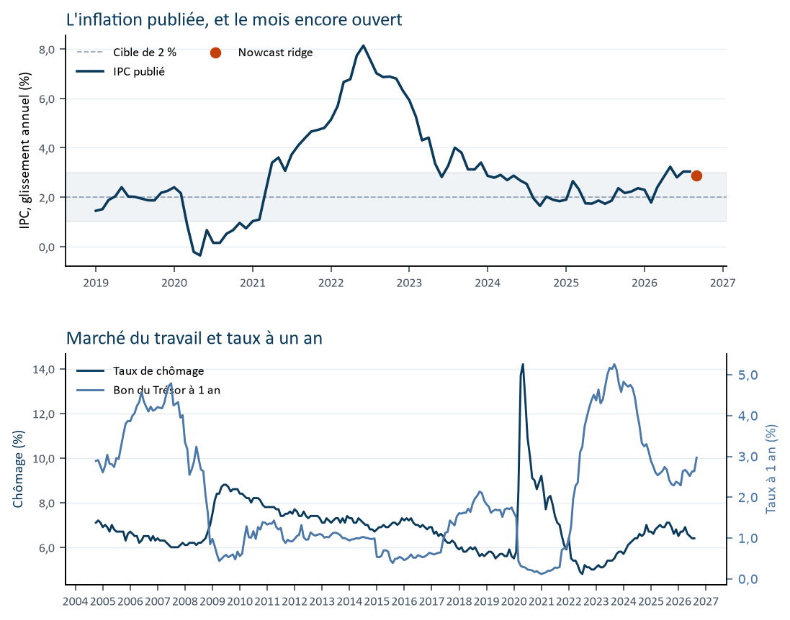
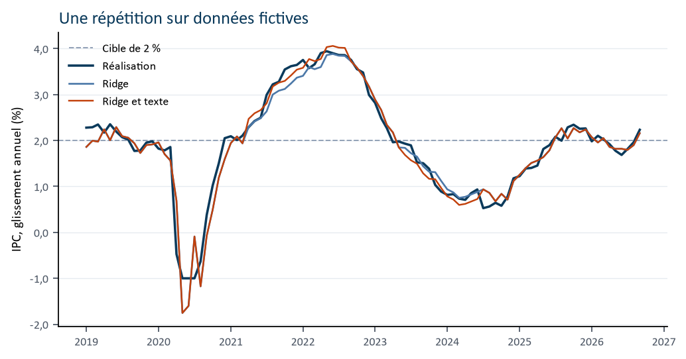
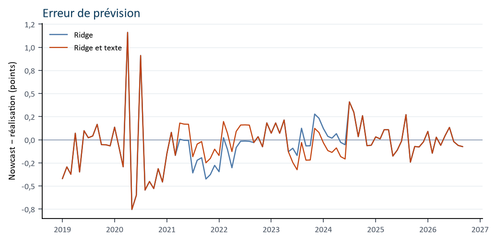

# Canadian inflation, read before the number

*Each month, before Statistics Canada’s release, a regression reads year-over-year CPI. It sees only what is already public.*

**Description.** Pseudo-real-time nowcast of Canadian CPI. A ridge regression reads the IT Now indicator block through a publication calendar and is scored, on the eve of each release, against historical Statistics Canada prints.

**Topics.** `nowcasting` `inflation` `cpi` `canada` `statistics-canada` `bank-of-canada` `pseudo-real-time` `ridge-regression` `macroeconomics`

Year-over-year CPI is how much the basket costs relative to twelve months earlier. The Bank of Canada’s target is 2 percent, the midpoint of a 1 to 3 percent range. This page is a working reading. It is not a forecast from the Bank of Canada.

The French article is `README.md`. The Word note is `rapports/Note_nowcast_IPC_Canada_0927.docx`.

<!-- reading:start -->
## The reading of 01 October 2026

The open month is **2026-09**. Fitted on 113 published months, the regression reads **2.88%** year over year. The 80% band runs from **2.43%** to **3.32%**. The probability of exceeding 2% is **0.994**.

Admissible text moves the reading by 0.042 points, to 2.92%.

On the synthetic rehearsal, mean absolute error is 0.18 percentage points over 93 months. The Brier score on the probability of exceeding 2% is 0.078.



*The blue line is CPI already published. The orange dot is the open month. The pale band is the 1 to 3 percent control range.*
<!-- reading:end -->

## What the number says

The reading is for the next CPI month that has not been released. An 80 percent band says where the print is likely to land if past errors repeat. The probability answers one question: how likely is the print to exceed 2 percent? A print of exactly 2 percent is not an exceedance.

## What goes into the reading

The indicator list follows [IT Now](https://naffe15.github.io/nowcast/), Filippo Ferroni’s nowcast of Italian GDP. Here the target is Canadian CPI. The open month of CPI does not enter the regression. Its published lags do, at one, two, three, and twelve months, together with retail volume, unemployment, household and business confidence, Canadian factory shipments, US industrial production, exports, imports, the latest published quarter of real GDP, and the one-year treasury bill.

## The clock

On the eve of CPI, the labour force is often already out. Retail, trade, and factories for that same month are not. The reading takes the latest public observation of each series and records how many months old it is.

A document enters only after the previous CPI release and on or before the reading. A page dated tomorrow stays out. Bank of Canada text can move the reading by at most a quarter of a point, and only for news the series do not already show, with a citation from the packet.

## Has the method been close before

The same rule is replayed on a synthetic Canada, on the eve of each release. Mean absolute error is the size of the miss. The Brier score grades the probabilities. The latest scores are in the reading at the top of the page. The rehearsal checks the calendar. It is not Canadian history.



*The blue line is the next morning’s print. The other two lines are the eve’s reading. The dashed line is the 2 percent target.*



*Above zero, the eve’s reading was too high.*

## The test on historical prints

The synthetic rehearsal checks the calendar. The score that matters uses Statistics Canada prints. Each month the ridge is refit on the eve of the release, using only series already public, and then compared with the next morning’s print. The benchmark is last month’s year-over-year rate. For a twelve-month inflation rate that is the natural competitor, because inflation moves slowly. Its probability uses the scale of its own past errors, recomputed on that eve.

The values are the latest vintage. The stylized calendar holds a month back until the hour treated as its first release. It does not rebuild the number as it was printed that morning. Retail volume, vector `v1446870181`, starts in February 2017, and the first complete model row is April 2017. With 60 months of training, required because the regressor list is about twenty series long, the first scored month is April 2022.

From April 2022 to September 2026, 54 months, the ridge’s mean absolute error is 0.35 percentage points. Last month’s rate misses by 0.33. The mean gap in absolute error is +0.02 points. The Diebold-Mariano statistic, with 12 Newey-West lags for the overlap in a year-over-year rate, is 0.57, and the two-sided probability is 0.57. On 54 months that gap sits inside the noise.

The split has an economic reading. In 2022–2023, 21 months while inflation was moving, the ridge misses by 0.42 points and last month’s rate by 0.45. From 2024, 33 months while inflation was gliding, last month’s rate misses by 0.26 and the ridge by 0.31. The ridge’s average bias is +0.10 points. The 80 percent band covers 72 percent of prints. The average in-sample residual scale is also 0.35 points: the average scale is right, and the shape of the errors is less so.

A 36-month training window opens the score in April 2020, 78 months. Mean absolute error is then 0.45 for the ridge and 0.37 for last month’s rate (statistic 1.46, probability 0.14). The gap is in 2020–2021: 0.65 against 0.43. A short sample estimated through the pandemic break misses the turn.

Month-by-month scores are in `rapports/pseudo_temps_reel.csv`. The scorecard is in `rapports/pseudo_temps_reel.txt`. Rebuild both with `python evaluate_history.py`.

## What this reading does not say

The calendar skips holidays other than weekends. Statistics Canada revisions stay in the values. The 80 percent band uses the in-sample residual scale. IT Now’s bands come from simulating a mixed-frequency Bayesian model. The estimator here is a ridge regression with a fixed penalty.

Canada has no Eurostat-style industrial production index. Real manufacturing shipments stand in. IT Now watches Germany for Italy. This reading watches the United States for Canada. Official text is the title, the date, and the summary, not the full speech.

## Where the series come from

| Series | Source | Identifier |
| --- | --- | --- |
| CPI, year over year | StatCan 18-10-0004 | v41690973 |
| Real GDP | StatCan 36-10-0104 | v62305752 |
| Retail volume | StatCan 20-10-0067 | v1446870181 |
| Unemployment | StatCan 14-10-0287 | v2062815 |
| Household confidence | OECD index, long-run average 100 | CCICP |
| Business confidence | OECD index, long-run average 100 | BCICP |
| Canadian factories | Manufacturing shipments, StatCan 16-10-0013 | v123263908 |
| US factories | FRED | INDPRO |
| One-year treasury bill | Bank of Canada Valet | V80691346 |
| Exports and imports | StatCan 12-10-0011 | v87008955, v87008839 |

Identifiers were checked on 30 October 2026.

```powershell
python build_report.py
```

## The formulas

They describe the calculation as it is estimated. The article can be read without opening them.

<details>
<summary>The mean of the open month</summary>

Month \(t\) is the first CPI print still strictly after time \(\tau\). The vector \(x_{t\mid\tau}\) contains only observations already public at that time.

$$
\pi_t = \beta_0 + x_{t\mid\tau}^{\top}\beta + \varepsilon_t
$$

\(\pi_t\) is year-over-year CPI, in percent. \(\beta_0\) is the baseline. \(\beta\) is the weight on each series. \(\varepsilon_t\) is what the series do not see.

</details>

<details>
<summary>What is inside the vector</summary>

Four CPI lags: one, two, three, and twelve months.

Then, for every other series, its latest public value and its age in months relative to the target month: retail volume, unemployment, household confidence, business confidence, manufacturing shipments, US industrial production, exports, imports, and the latest published quarter of real GDP. The one-year treasury bill at time \(\tau\) closes the vector.

Weights are applied to series scaled to mean zero and unit variance on the published sample only. The intercept is not penalized.

</details>

<details>
<summary>How the weights are estimated</summary>

\(\mathcal{T}_\tau\) is the set of months whose CPI is already public at \(\tau\). For each, \(z_s\) is the standardized vector built on the eve of that month’s own release. \(\alpha\) is fixed at 1.

$$
\hat\beta
= \arg\min_{\beta}
\sum_{s \in \mathcal{T}_\tau}
\left(\pi_s - \beta_0 - z_s^{\top}\beta\right)^2
+ \alpha \|\beta\|^2
$$

</details>

<details>
<summary>The reading of the open month</summary>

$$
\hat\pi_{t\mid\tau}
= \hat\beta_0 + z\!\left(x_{t\mid\tau}\right)^{\top}\hat\beta
$$

</details>

<details>
<summary>The typical error and the 80 percent band</summary>

The scale is the in-sample residual standard deviation, with \(n_\tau - 1\) in the denominator. A floor of 0.05 points keeps the probability off 0 and 1.

$$
\hat\sigma_\tau
= \sqrt{
\frac{1}{n_\tau - 1}
\sum_{s \in \mathcal{T}_\tau}
\left(\pi_s - \hat\pi_s(\tau)\right)^2
}
$$

The 80 percent band is \(\hat\pi_{t\mid\tau} \pm 1.28\,\hat\sigma_\tau\).

</details>

<details>
<summary>The probability of exceeding 2 percent</summary>

$$
P(\pi_t > 2)
= 1 - \Phi\!\left(
\frac{2 - \hat\pi_{t\mid\tau}}{\max(\hat\sigma_\tau,\ 0.05)}
\right)
$$

\(\Phi\) is the standard normal distribution function.

</details>

<details>
<summary>What the text can add</summary>

\(c_\tau\) is a confidence between 0 and 1. \(\delta_\tau\) is clipped to −0.25 to +0.25 points. The residual scale does not change.

$$
\tilde\pi_{t\mid\tau}
= \hat\pi_{t\mid\tau}
+ c_\tau \cdot \mathrm{clip}(\delta_\tau,\ -0.25,\ 0.25)
$$

</details>

<details>
<summary>How the method is scored</summary>

\(p_i\) is the announced probability. The indicator is 1 only when the released CPI is strictly above 2 percent.

$$
\mathrm{MAE}
= \frac{1}{N} \sum_{i=1}^{N} \left| \hat\pi_i - \pi_i \right|
$$

$$
B
= \frac{1}{N} \sum_{i=1}^{N}
\left( p_i - \mathbf{1}(\pi_i > 2) \right)^2
$$

</details>
